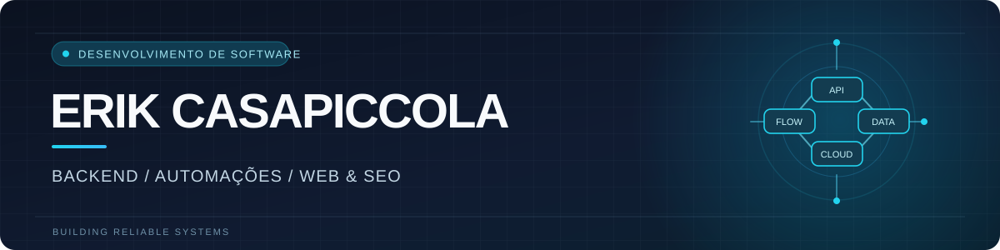

  

  <strong>Desenvolvedor de Software · Backend, Automações &amp; Web</strong> 
  Estudante de Análise e Desenvolvimento de Sistemas (3º semestre)

  <a href="#sobre-mim">Sobre</a> &nbsp;·&nbsp;
  <a href="#áreas-de-atuação">Atuação</a> &nbsp;·&nbsp;
  <a href="#case-profissional">Case profissional</a> &nbsp;·&nbsp;
  <a href="#tecnologias">Tecnologias</a> &nbsp;·&nbsp;
  <a href="#projetos-públicos">Projetos</a>

---

### Sobre mim

Sou desenvolvedor de software com foco em **backend, automação de processos e integração entre sistemas**. Minha atuação também inclui **desenvolvimento web e SEO técnico**, conectando APIs, bancos de dados, interfaces e canais digitais a necessidades reais de negócio.

Gosto de entender o problema de ponta a ponta: desde a regra de negócio e o fluxo de dados até a implementação, os testes e a operação. Paralelamente à experiência prática, sigo aprofundando minha formação em **Análise e Desenvolvimento de Sistemas**.

### Áreas de atuação

| Área | Experiência prática |
| :--- | :--- |
| **Backend & APIs** | Desenvolvimento de serviços, endpoints REST e integrações com plataformas externas. |
| **Automação** | Fluxos com n8n, scripts Python, Selenium, webhooks e processamento de dados. |
| **Dados & infraestrutura** | PostgreSQL, Redis, Docker, serviços em nuvem e observabilidade operacional. |
| **Aplicações integradas** | Conexão entre CRM, formulários, painéis e canais de atendimento. |
| **Desenvolvimento web & SEO** | Sites, landing pages, experiência de navegação, indexação e otimizações técnicas para mecanismos de busca. |

### Case profissional

#### Soma Soluções — desenvolvimento full stack, integrações com CRM e SEO

Atuo no desenvolvimento e na evolução do **ecossistema web da [Soma Soluções](https://www.somasoluciona.com.br/)**, empresa do setor financeiro. É um trabalho **full stack** que conecta interfaces, APIs, conteúdo e processos comerciais: do site e das landing pages às integrações que sustentam a operação.

**Principais frentes de atuação:**

- **Frontend e experiência web:** desenvolvimento e manutenção do site institucional e de landing pages responsivas com **React, TypeScript, Vite e Tailwind CSS**, incluindo jornadas de simulação e captação de leads.
- **Backend Java:** desenvolvimento de APIs com **Java e Spring Boot** para apoiar as funcionalidades do site e a **administração de conteúdos do blog**.
- **Integração direta com CRM:** conexão de formulários e fluxos de leads com o CRM, integrando a experiência do visitante aos processos comerciais e às automações.
- **Blog e gestão de conteúdo:** evolução da estrutura de publicação e administração de artigos, categorias e páginas de conteúdo.
- **SEO técnico e conteúdo:** organização de URLs, metadados, canonicals, indexabilidade, páginas de produtos e acompanhamento de desempenho no **Google Search Console**.
- **Automação e operação:** integrações entre sistemas, webhooks e rotinas que apoiam o fluxo de informações entre as aplicações.

**Tecnologias envolvidas:** `React` · `TypeScript` · `Java` · `Spring Boot` · `REST APIs` · `PostgreSQL` · `n8n` · `SEO técnico`

**Exemplos públicos:** [Site institucional](https://www.somasoluciona.com.br/) · [Landing page SomaCar — empréstimo com garantia de veículo](https://www.somasoluciona.com.br/somacar/emprestimo-garantia-veiculo)

> Este é um **case de atuação profissional em um projeto da empresa**. Os links levam apenas a páginas públicas; código-fonte, configurações, dados de clientes e detalhes internos das integrações permanecem privados.

### Tecnologias

  
  &nbsp; 
  &nbsp; 
  &nbsp; 
  &nbsp; 
  &nbsp; 
  &nbsp; 
  &nbsp; 

  <code>Java</code> <code>Spring Boot</code> <code>Python</code> <code>TypeScript</code> <code>REST APIs</code> <code>PostgreSQL</code> 
  <code>n8n</code> <code>Selenium</code> <code>Redis</code> <code>Docker</code> <code>Cloudflare Workers</code> <code>Git</code>

### Projetos públicos

| Repositório | O que você encontra |
| :--- | :--- |
| [**Java + JDBC · Padrão DAO**](https://github.com/Casapiccola/demo-dao-jdbc) | Exercício de persistência relacional com JDBC, consultas e operações CRUD no padrão DAO. |
| [**Spring Boot · Fundamentos de API**](https://github.com/Casapiccola/springboot-jpa-curso) | Projeto de estudo em Java com um endpoint HTTP, estrutura inicial Spring Boot e dependências para persistência. |
| [**ADS · Atividades acadêmicas**](https://github.com/Casapiccola/FaculdadeADS-Ulbra) | Evolução de estudos em frontend, backend e programação orientada a objetos. |

> **Nota:** parte do meu trabalho envolve sistemas e integrações de uso interno. Por isso, nem todas as entregas profissionais possuem código público neste perfil.

### Em evolução

Estou aprofundando conhecimentos em **Java, Spring Boot, arquitetura de APIs, testes e boas práticas de backend**, conectando o aprendizado acadêmico à experiência de desenvolvimento.

### Atividade no GitHub

  
Visualizar gráfico de contribuições

   
  <picture>
    <source media="(prefers-color-scheme: dark)" srcset="https://raw.githubusercontent.com/Casapiccola/Casapiccola/output/pacman-contribution-graph-dark.svg" />
    <source media="(prefers-color-scheme: light)" srcset="https://raw.githubusercontent.com/Casapiccola/Casapiccola/output/pacman-contribution-graph.svg" />
    
  </picture>

---

Projetos, aprendizado contínuo e soluções que fazem sentido fora do editor.

